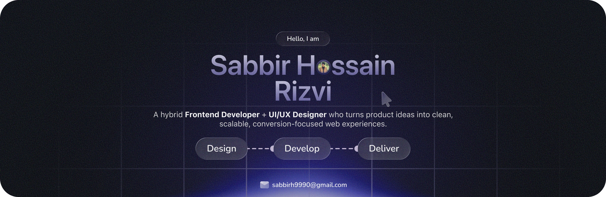

# Hi there! 

### I'm **Sabbir Hossain Rizvi**
#### 🚀 Frontend Developer · UI/UX Designer

 

 

##  About Me

Frontend-focused developer based in **Dhaka, Bangladesh** with hands-on experience in **React, Next.js, TypeScript, Tailwind CSS, ShadCN UI, Supabase** and **Figma**. I love building clean, responsive and user-friendly web applications while growing with modern product teams.

- 🔭 Currently working as a **Frontend Engineer & UI/UX Designer** at [Arohon](https://arohon.com) — building product flows for ride-sharing & mobility
- 💼 Also contributing as a **Frontend Developer & QA Tester** at [FlexLab Studio](https://flexlabstudio.com) (US-based, remote)
- 🌱 Exploring **Next.js App Router**, **Supabase** real-time features & advanced **TypeScript** patterns
- 🛠️ Recently built [**Woff Space**](https://woffspace.vercel.app) — a short-link note sharing platform with Next.js & Supabase
- 🎓 Pursuing **B.Sc in Computer Science Engineering** at Stamford University Bangladesh (2023 – 2026)
- ⚡ Fun fact: I've been crafting web experiences since **2016**!

 

## 🛠️ Skills & Technologies

### 🎨 Frontend

  
  
  
  
  
  
  
  

### ⚙️ Backend & Database

  
  
  
  
  

### 🎨 Design & Tools

  
  
  
  
  
  

 

## 📊 GitHub Stats

  

 

  

 

## 🌐 Connect with Me

 

  

