[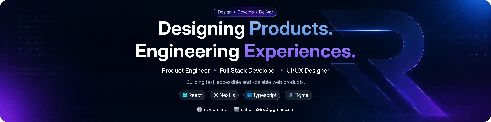](https://rizvi.pro.bd/)

# Sabbir Hossain Rizvi

I’m a full-stack software engineer and UI/UX designer based in **Dhaka, Bangladesh**. I take web and mobile products from the first Figma prototype through to the interfaces, APIs, and databases they run on.

[Portfolio](https://rizvi.pro.bd/) · [LinkedIn](https://www.linkedin.com/in/sabbirrizvi/) · [Email me](mailto:sabbirh9990@gmail.com)

## Current work

**Arohon** · Co-founder and Head of Engineering 
I lead engineering for a mobility and delivery service in Bangladesh. I build the booking and live tracking features that connect riders with drivers, and the web tools our team uses to verify drivers and manage trips.

**Flexpoint** · Co-founder 
I design and build the storefront setup, checkout, and dashboards that creators use to sell digital products and services.

## Selected projects

| Project | What you can do |
| --- | --- |
| **[Woff Space](https://github.com/RizviBR0/Woff)** | Share files, notes, and code in a room anyone can join with a link or room code. [Woff Space case study](https://rizvi.pro.bd/projects/woff-space) |
| **[Loome](https://github.com/RizviBR0/loome-client)** | Publish design work, browse other designers’ projects, and give feedback. [Loome case study](https://rizvi.pro.bd/projects/loome) |
| **[IdeaVault](https://github.com/RizviBR0/ideavault-client)** | Publish a startup idea and discuss it with other founders in a comment thread. [IdeaVault case study](https://rizvi.pro.bd/projects/ideavault) |

## Skills & technologies

**Frontend** 

[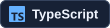](https://www.typescriptlang.org/)
[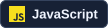](https://developer.mozilla.org/en-US/docs/Web/JavaScript)

[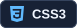](https://developer.mozilla.org/en-US/docs/Web/CSS)

**Mobile & native Android** 
[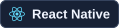](https://reactnative.dev/)

**Backend & databases** 
[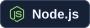](https://nodejs.org/)

**Design & publishing** 
[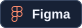](https://www.figma.com/)
[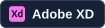](https://helpx.adobe.com/xd/desktop.html)

**Version control** 
[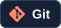](https://git-scm.com/)

**Product engineering** · Software architecture, technical leadership, API design, authentication, and third-party integrations. 
**UI/UX & QA** · User flows, wireframes, interactive prototypes, usability checks, and exploratory, UI, and functional testing.

More languages and tools I’ve worked with

| Area | Skills |
| --- | --- |
| Programming | C, C++, Java, Python |
| Web development | Django, Redux, Bootstrap, Sass, webpack |
| Mobile & embedded | Flutter, Arduino |
| Databases & data science | MySQL, pandas, PyTorch |
| Visual design | Adobe Illustrator, Adobe Photoshop |
| Development tools | Docker, Linux, Postman |

## GitHub activity

  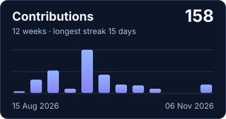
  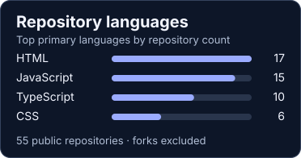

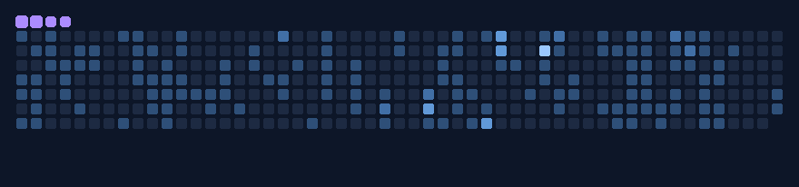

[Browse my repositories](https://github.com/RizviBR0?tab=repositories)
